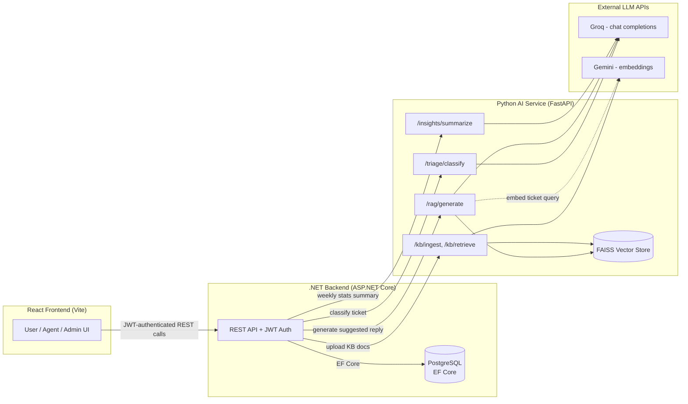
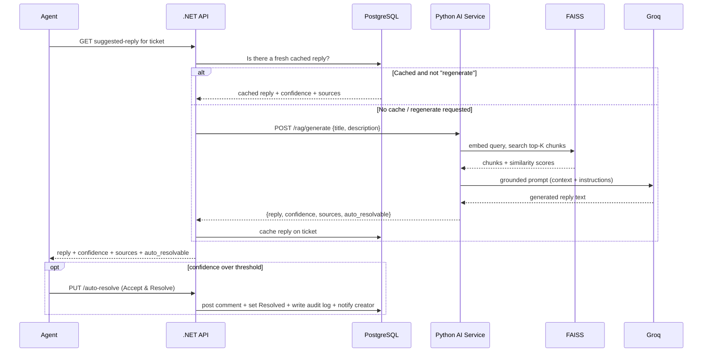

# Support Ticket System (with RAG-Assisted Support)

A full-stack support ticket system built as a learning project: ASP.NET Core backend
with role-based ticketing, a Python FastAPI service providing AI ticket triage and
retrieval-augmented reply generation, and a React frontend for Users, Agents, and
Admins.

## Project Overview

Users file support tickets. An AI service automatically categorizes and prioritizes
them. Agents work a queue, get an AI-generated *suggested reply* grounded in a
company knowledge base (with citations), and can accept high-confidence suggestions
with one click or edit them before sending. Admins manage users/roles, ingest
knowledge-base documents, view AI-generated weekly analytics, and review an audit
trail of every sensitive action in the system. Both the ticket creator and the
assigned agent get in-app notifications when something relevant happens to a ticket.

Every AI-assisted action in this system is designed to keep a human in the loop -
see [Key Design Decisions](#key-design-decisions) below.

## Architecture



### Request flow: an Agent viewing a ticket with an AI-suggested reply



## Tech Stack

**Backend**
- ASP.NET Core Web API (.NET)
- Entity Framework Core + PostgreSQL (via Npgsql)
- ASP.NET Core Identity + JWT Bearer authentication
- Role-based authorization (User / Agent / Admin)

**AI Service**
- Python, FastAPI, Pydantic v2
- Groq (OpenAI-compatible API) for chat completions
- Google Gemini for text embeddings
- FAISS for vector similarity search

**Frontend**
- React (Vite)
- Redux Toolkit + RTK Query

## Features by Area

- **Auth & Roles**: JWT login, seeded Admin, User/Agent/Admin roles, account deactivation.
- **Tickets**: creation, comments, status lifecycle, agent assignment/queue.
- **AI Triage**: automatic category + priority classification on ticket creation, with manual override.
- **Knowledge Base**: Admin PDF/TXT upload, chunking, embeddings, FAISS storage.
- **RAG Suggested Replies**: grounded, cited draft replies for agents, cached per ticket, regenerate on demand.
- **Auto-Resolve**: high-confidence suggestions get a one-click "Accept & Resolve" (still human-triggered).
- **Weekly Insights**: AI-summarized 7-day ticket analytics for Admins, cached for an hour.
- **Notifications**: in-app bell/dropdown - ticket creators notified on resolution, agents notified on assignment.
- **Audit Log**: one consistent, filterable trail of auto-resolves, manual status changes, role changes, and deactivations.

## Setup Instructions

### Prerequisites
- .NET SDK (10.0+)
- PostgreSQL (local install, Docker, or point at a remote instance - e.g. the same free Render Postgres used in production)
- Python 3.11+
- Node.js 18+

### 1. Backend (`SupportTicketSystem/`)

```bash
cd SupportTicketSystem
dotnet restore
```

Configure `appsettings.json` (or user secrets) with:
- `ConnectionStrings:DefaultConnection` - your PostgreSQL connection string, either the
  classic keyword/value form (`Host=localhost;Port=5432;Database=SupportTicketDb;Username=...;Password=...`)
  or a `postgres://` URI (Render hands these out directly) - `Program.cs` normalizes
  either form automatically.
- `Jwt:Key` / `Jwt:Issuer` / `Jwt:Audience` - JWT signing config
- `SeedAdmin:Email` / `SeedAdmin:Password` - seeded Admin account, created on first run
- `RagService:BaseUrl` - URL of the Python AI service (default `http://localhost:8001`)

Migrations apply automatically on startup (`Database.MigrateAsync()` in `Program.cs`), so
just run:

```bash
dotnet run
```

The API listens on `http://localhost:5228` by default.

### 2. AI Service (`SupportTicketAI/`)

```bash
cd SupportTicketAI
python -m venv venv
venv\Scripts\activate        # venv/bin/activate on macOS/Linux
pip install -r requirements.txt
```

Create a `.env` file:

```dotenv
GROQ_API_KEY=your-groq-api-key
GEMINI_API_KEY=your-gemini-api-key
AUTO_RESOLVE_THRESHOLD=0.9
```

Run:

```bash
uvicorn main:app --host 127.0.0.1 --port 8001
```

### 3. Frontend (`support-ticket-frontend/`)

```bash
cd support-ticket-frontend
npm install
```

Create a `.env` file:

```dotenv
VITE_API_BASE_URL=http://localhost:5228/api
```

Run:

```bash
npm run dev      # dev server at http://localhost:5173
npm run build    # production build
```

## Key Design Decisions

### Why human-in-the-loop auto-resolve, instead of full automation

A high retrieval-similarity score only proves the ticket's wording *matched* the
knowledge base well - it doesn't prove the generated reply is actually correct, or
that it accounts for the specific customer's nuance. Letting the system resolve a
ticket (and send a reply) entirely on its own means a wrong or subtly-off answer can
go out unreviewed, close a ticket that isn't really solved, and erode customer trust
with nobody accountable for the mistake. Every AI-assisted action in this system -
suggested replies and auto-resolve alike - is therefore a *recommendation* an Agent
sees and explicitly acts on ("Accept & Resolve" is one click, but it's still a
click), and that action is logged in the audit trail with the confidence score at
the time it was taken.

### Why graceful degradation on AI failures, not hard failures

Every integration with the AI service is built so an outage or error there degrades
the experience rather than breaking it entirely:
- Ticket classification falls back to `Uncategorized` / `Medium` if the classifier is
  unavailable - a ticket can still be created and triaged manually.
- The Weekly Insights dashboard shows a "summary temporarily unavailable" message but
  still renders the real, server-computed stats/charts if the LLM summarization call
  fails - the numbers don't depend on the LLM succeeding.
- RAG generation and KB ingestion are the exceptions: they *do* surface a clear error
  instead of a silent fallback, because there's no safe placeholder for "a suggested
  reply" or "an ingested document" - inventing one would be actively misleading. The
  general principle is the same either way: never let an AI failure silently produce
  wrong-looking-right output; either degrade to a clearly-labeled fallback, or fail
  loudly.

### Why confidence is derived from retrieval similarity, not LLM self-reporting

The confidence score attached to every suggested reply is the top similarity score
from the knowledge-base vector search, not a number the LLM is asked to report about
its own answer. Three reasons:
1. **It's already computed.** Retrieval happens before generation regardless - reusing
   its top score costs no extra LLM call, no extra latency, no extra cost.
2. **It's deterministic and meaningful.** It directly answers the question that
   matters: "how well does the knowledge base actually cover this ticket?" A low score
   honestly means "the KB probably doesn't have the answer," which is exactly when an
   Agent should distrust the draft.
3. **LLM self-reported confidence is unreliable.** Language models are known to be
   poorly calibrated at self-assessing correctness - a hallucinated answer is often
   reported with just as much apparent confidence as a well-grounded one, since the
   "confidence" is itself just more generated text, not a measured probability.

## Deployment (Render, all-in)

This repo includes `render.yaml` (a Render Blueprint) plus a `Dockerfile` in both
`SupportTicketSystem/` and `SupportTicketAI/`, so the backend and AI service deploy as
Docker web services, the frontend deploys as a static site, and the database is a free
Render-managed PostgreSQL instance - no self-hosting, no firewall/port-forwarding setup,
everything in one provider.

### 0. Push this repo to GitHub
Render deploys from a connected Git provider. Create a repo on GitHub and push this
one to it (`git remote add origin ...`, `git push -u origin main`).

### 1. Create everything via the Blueprint
Go to **New > Blueprint** in the Render dashboard, point it at your GitHub repo, and
Render reads `render.yaml` and proposes all four resources at once: the Postgres
database, both Docker web services, and the static frontend. Otherwise, create each
manually:
- `support-ticket-db`: free Postgres instance.
- `support-ticket-ai`: Docker web service, Dockerfile at `SupportTicketAI/Dockerfile`, root `SupportTicketAI/`.
- `support-ticket-backend`: Docker web service, Dockerfile at `SupportTicketSystem/Dockerfile`, root `SupportTicketSystem/`.
- `support-ticket-frontend`: Static site, build command `cd support-ticket-frontend && npm install && npm run build`, publish path `support-ticket-frontend/dist`.

### 2. Set environment variables
On `support-ticket-ai`:
- `GROQ_API_KEY`, `GEMINI_API_KEY` - your real keys (never commit these).
- `AUTO_RESOLVE_THRESHOLD` - `0.9` (or your tuned value).

On `support-ticket-backend`:
- `ConnectionStrings__DefaultConnection` - via the Blueprint's `fromDatabase` wiring,
  this is filled in automatically from `support-ticket-db`'s connection string; no
  manual step needed.
- `Jwt__Key` - a real random secret (e.g. `openssl rand -base64 48`), **not** the
  placeholder in `appsettings.json`.
- `Jwt__Issuer` / `Jwt__Audience` - can keep the defaults.
- `SeedAdmin__Email` / `SeedAdmin__Password` - **do not** deploy publicly with the
  default `admin@example.com` / `Admin@123` from local dev; the seed logic creates
  this account automatically on first boot if it doesn't already exist.
- `RagService__BaseUrl` - the public URL Render gives `support-ticket-ai`
  (e.g. `https://support-ticket-ai.onrender.com`).
- `Cors__FrontendOrigin` - the public URL Render gives `support-ticket-frontend`.

On `support-ticket-frontend`:
- `VITE_API_BASE_URL` - the public URL Render gives `support-ticket-backend`, plus
  `/api` (e.g. `https://support-ticket-backend.onrender.com/api`). Vite bakes this in
  at **build** time, so set it before the first build, or trigger a redeploy after
  changing it.

### 3. Deploy order
Backend and frontend each need the other's URL, which only exists after that service
is first created - so expect to: create all four resources, fill in what you can,
deploy, then go back and fill in `RagService__BaseUrl` / `Cors__FrontendOrigin` /
`VITE_API_BASE_URL` once you have the real URLs, then redeploy the backend and frontend.
The database schema is created automatically on the backend's first boot
(`Database.MigrateAsync()` in `Program.cs`) - no separate migration step.

### Known limitations of this setup
- **Free web services spin down after inactivity** and cold-start on the next request
  (can take 30-60s) - acceptable for a demo, not for production SLAs.
- **Free Render Postgres instances expire after 30 days** unless upgraded to a paid
  plan - fine for a demo/portfolio project, not for anything long-lived.
- **The AI service's FAISS knowledge-base data is not persisted** on Render's free
  tier (no free persistent disk) - ingested documents are lost on redeploy/restart.
  A paid persistent disk, or moving `kb_data/` to external storage, would fix this.

## Notable Limitations / Future Work

- Notifications are polled (every 30s), not pushed via websockets/SignalR.
- No real email delivery - notifications are in-app only.
- No charting library - Weekly Insights uses simple CSS bar breakdowns.
- Single-instance in-memory caching (Weekly Insights) - would need a distributed cache
  (e.g. Redis) to run behind multiple backend instances.
